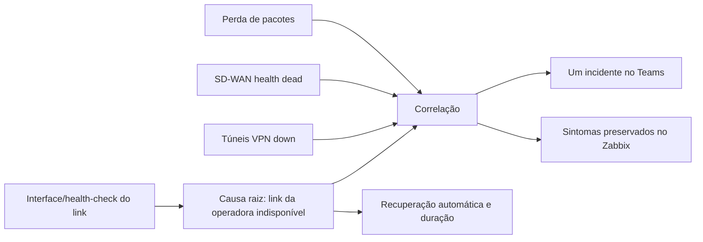

# Roadmap — correlação de quedas de link no Zabbix

Data-base da análise: 30/09/2026  
Escopo: firewalls FortiGate, links de operadoras, túneis VPN, SD-WAN e alertas no Teams

## Objetivo

Transformar uma queda de operadora em um único incidente acionável, mantendo os sintomas relacionados disponíveis no Zabbix para diagnóstico, mas sem gerar chuva de alertas ou distorcer o SLA.

Fluxo desejado:

## Estado atual confirmado

- Existem 59 correlações ativas; 55 têm relação com link, operadora, ISP ou VPN.
- A maioria está organizada em pares: uma regra fecha sintomas novos enquanto a causa está aberta e outra fecha sintomas que já estavam abertos quando a causa apareceu.
- A taxonomia não é uniforme. A mesma classe de causa aparece como `ISP1_VIVO`, `SCL_ISP1_VPN`, `HK_VIVO`, `SPO_VIVO` e outros valores.
- Entre 01/09 e 30/09, a API atingiu o limite de 2.000 resultados em cada uma destas categorias:
  - `Tunnel down` — pelo menos 2.000 eventos;
  - `High packets loss` — pelo menos 2.000 eventos;
  - `Health check state is dead` — pelo menos 2.000 eventos.
- Nos 2.000 eventos de perda de pacotes consultados, 1.300 pertencem ao `SPO-CPD-FW01`.
- Problemas atualmente abertos:
  - 3 interfaces `Link down`;
  - 2 túneis `Tunnel down`;
  - 2 eventos antigos de `High packets loss`;
  - nenhum `Health check state is dead` aberto.
- Duas interfaces abertas em `BRAS-CPD-FW01` têm `depends-on` vazio ou pouco específico, impedindo correlação confiável.
- Há eventos de perda de pacotes ainda abertos desde maio; isso indica ausência de recuperação simétrica ou objeto que deixou de coletar.

## Contrato de tags proposto

As correlações devem depender de tags, não do texto do nome da trigger.

### Evento de causa raiz

| Tag | Exemplo | Regra |
| --- | --- | --- |
| `class` | `network` | obrigatória |
| `component` | `wan-link` | obrigatória |
| `scope` | `availability` | obrigatória para link indisponível |
| `site` | `scl` | código normalizado do site |
| `carrier` | `vivo` | operadora normalizada |
| `link-id` | `scl.vivo.isp1` | identificador canônico e único |
| `link-cause` | `scl.vivo.isp1` | igual ao `link-id` durante a migração |
| `notify` | `teams` | somente nas causas aprovadas |

### Evento de sintoma

| Tag | Exemplo | Regra |
| --- | --- | --- |
| `class` | `network` | obrigatória |
| `component` | `vpn`, `sd-wan` | tipo do sintoma |
| `scope` | `availability` ou `performance` | queda e perda de pacotes não devem compartilhar o mesmo escopo |
| `depends-on` | `scl.vivo.isp1` | deve apontar para o `link-id` canônico |
| `site` | `scl` | origem do sintoma |
| `slahost` | `SCL-CPD-FW01` | quando participar de SLA |

`scope=performance` deve ser usado para perda de pacotes. `scope=availability` fica reservado a indisponibilidade real.

## Roadmap de implantação

### Fase 0 — baseline e proteção (2 dias)

1. Exportar backup das 59 correlações, template FortiGate, triggers/protótipos e ação do Teams.
2. Criar uma matriz com site, firewall, operadora, interface, health-check, túneis dependentes e `link-id` desejado.
3. Registrar a linha de base de 30 dias:
   - eventos por causa e por sintoma;
   - mensagens enviadas ao Teams;
   - eventos encerrados por correlação;
   - problemas antigos sem recuperação;
   - impacto no SLA.
4. Congelar criação manual de novas tags de correlação durante a migração.

**Aceite:** inventário completo e restaurável; nenhum objeto alterado sem backup.

### Fase 1 — padronização das causas (3 dias)

1. Definir um `link-id` único por circuito no formato `site.operadora.saida`.
2. Eleger uma única trigger de causa por circuito, preferencialmente a disponibilidade física/health-check do link.
3. Aplicar persistência de 5 minutos para abertura e estabilidade mínima para recuperação.
4. Marcar perda de pacotes como desempenho e impedir que ela se torne a causa raiz de indisponibilidade.
5. Corrigir triggers com `depends-on` vazio e documentar interfaces administrativas que devem permanecer desativadas.

**Aceite:** 100% dos circuitos têm uma causa identificável, recuperação automática e tags canônicas.

### Fase 2 — padronização dos sintomas (4 dias)

1. Atualizar protótipos de VPN e SD-WAN no template, evitando ajustes host a host.
2. Fazer `depends-on` apontar para o `link-id` canônico da saída utilizada.
3. Tratar túneis dial-up, administrativamente inativos e enlaces de contingência com regra própria para não gerar falso incidente.
4. Garantir que as duas pontas do túnel apontem para a mesma causa quando compartilham o circuito.

**Aceite:** nenhum sintoma sem `depends-on`; nenhum sintoma aponta para mais de uma causa incompatível.

### Fase 3 — modelo único de correlação e piloto (1 semana)

1. Gerar sempre um par controlado por circuito:
   - regra A: fecha novos sintomas enquanto a causa está ativa;
   - regra B: fecha sintomas já abertos quando a causa aparece.
2. Remover sobreposição entre regras antigas e o novo par.
3. Pilotar em `SCL + VIVO`, cenário que já apresentou oscilação real.
4. Testar quatro sequências:
   - causa antes do sintoma;
   - sintoma antes da causa;
   - recuperação da causa;
   - nova oscilação dentro e fora da janela de 5 minutos.
5. Validar que um túnel de outra operadora continua visível e não é encerrado indevidamente.

**Aceite:** uma causa visível, sintomas correlacionados corretamente e nenhuma supressão cruzada.

### Fase 4 — Teams e fluxo operacional (3 dias)

1. Manter a ação do Teams com lista controlada de causas aprovadas.
2. Enviar ao Teams somente a causa raiz; sintomas permanecem no Zabbix para troubleshooting.
3. Padronizar o cartão:
   - site e operadora;
   - link/circuito;
   - horário em `dd/MM/yyyy HH:mm:ss`;
   - duração;
   - quantidade e nomes dos serviços/túneis afetados;
   - botão para abrir o evento no Zabbix;
   - ação sugerida e runbook.
4. Na recuperação, enviar um único cartão verde com a duração e a causa normalizada.

**Aceite:** uma mensagem de abertura e uma de recuperação por queda de circuito.

### Fase 5 — expansão por ondas (2 semanas)

| Onda | Escopo | Critério para avançar |
| --- | --- | --- |
| 1 | SCL: VIVO e ALGAR | 7 dias sem correlação indevida |
| 2 | BGP: CROSSCNT e VIVO | redução mínima de 80% no ruído de VPN |
| 3 | SPO: VIVO e ALGAR | estabilizar o `SPO-CPD-FW01`, hoje maior gerador de eventos |
| 4 | FIA, DENIM, BRAS e Azure | todos os testes de causa/sintoma aprovados |

Cada onda deve seguir: backup → alteração mínima → evento controlado → validação no Zabbix → validação no Teams → janela de observação → rollback se necessário.

### Fase 6 — governança contínua

1. Revisão semanal durante o primeiro mês e mensal depois disso.
2. Dashboard operacional com:
   - quedas por site e operadora;
   - flapping por circuito;
   - sintomas por causa;
   - tempo médio de recuperação;
   - eventos correlacionados e não correlacionados;
   - problemas sem recuperação há mais de 24 horas.
3. Toda nova operadora ou firewall entra pela matriz de tags e pelo template, nunca por correlação isolada criada diretamente no host.

## Indicadores de sucesso

- Redução de pelo menos 80% nas notificações de sintomas no Teams.
- Uma abertura e uma recuperação por incidente de operadora.
- 100% das causas com `link-id`, `carrier`, `site` e `link-cause`.
- 100% dos sintomas de VPN/SD-WAN com `depends-on` válido.
- Zero problema de link sem recuperação há mais de 24 horas sem justificativa documentada.
- Zero evento de desempenho contabilizado como indisponibilidade no SLA.
- Zero sintoma de outra operadora encerrado pela correlação errada.

## Backlog priorizado

| Prioridade | Entrega | Motivo |
| --- | --- | --- |
| P0 | Investigar os dois `High packets loss` abertos desde maio | recuperação quebrada ou item obsoleto |
| P0 | Corrigir `depends-on` vazio nas interfaces de BRAS | impede correlação determinística |
| P0 | Analisar flapping do `SPO-CPD-FW01` | concentra 65% da amostra de perda de pacotes |
| P1 | Criar matriz canônica de circuitos e tags | reduz as 55 regras difíceis de manter |
| P1 | Pilotar o par de correlações em SCL/VIVO | valida o modelo com risco controlado |
| P1 | Padronizar cartão raiz/recuperação no Teams | melhora triagem e resposta |
| P2 | Gerar correlações a partir da matriz | evita divergência manual entre sites |
| P2 | Dashboard de qualidade das correlações | sustenta governança e auditoria |

## Dados consultados

- `correlation.get` com filtros e operações: 59 correlações ativas.
- `event.get` de 01/09/2026 a 30/09/2026 para link, túnel, perda de pacotes e health-check.
- `problem.get` para o estado atual dos mesmos quatro tipos de problema.
- Evidências salvas em `backups/audit_link_*_20260930.json` e `backups/audit_events_*_september_20260930.json`.

## Execução em 30/09/2026

### Concluído

- Backup das 59 correlações, do template FortiGate, das ações e dos tipos de mídia do Teams.
- Matriz das 59 regras criada em `reports/link-correlation-matrix-20260930.csv`.
- Confirmadas 32 regras `close_new` e 27 regras `close_old`; 11 causas aparecem em mais de duas regras.
- O evento antigo `13637090`, que estava preso desde maio apesar de 30 coletas consecutivas em 0% de perda, foi fechado de forma controlada. O trigger `45644` voltou a `OK` e o Zabbix gerou o evento de recuperação `18497596`.
- O segundo evento antigo, trigger `45473`, foi mantido porque as 30 coletas auditadas permaneciam em 100% de perda.
- O piloto identificou a causa da tempestade atual: as correlações 16 e 45 encerravam sintomas persistentes imediatamente. O Zabbix os reabria no ciclo seguinte.
- Ao desativar temporariamente as duas regras, os sintomas deixaram de repetir e permaneceram como seis problemas únicos. As regras foram restauradas após a proteção temporária no Teams ser recusada pela revisão automática.

### Evidência do piloto

- Antes: 1.000 eventos do SCL em 83 minutos, sendo 500 recuperações atribuídas à correlação 45.
- Com a correlação 45 desativada: a regra antiga 16 continuou a repetição, comprovando sobreposição.
- Com as correlações 16 e 45 desativadas: seis sintomas únicos permaneceram abertos, sem novo ciclo de fechamento/reabertura durante a observação.
- Estado final seguro: correlações 16 e 45 restauradas; ação 22 do Teams permaneceu inalterada com atraso de 5 minutos.

### Próxima mudança controlada

Alterar a ação 22 para manter `notify=teams` como autorização explícita de causa raiz e excluir do caminho genérico de severidade os eventos com `depends-on`; depois substituir progressivamente as regras `close_new` por sintomas persistentes e não notificáveis. Essa mudança precisa de aprovação explícita porque afeta globalmente a seleção de mensagens do Teams.

As alterações continuam seguindo o runbook `zabbix-senior-analyst`: backup, mudança mínima, piloto, validação e rollback.
