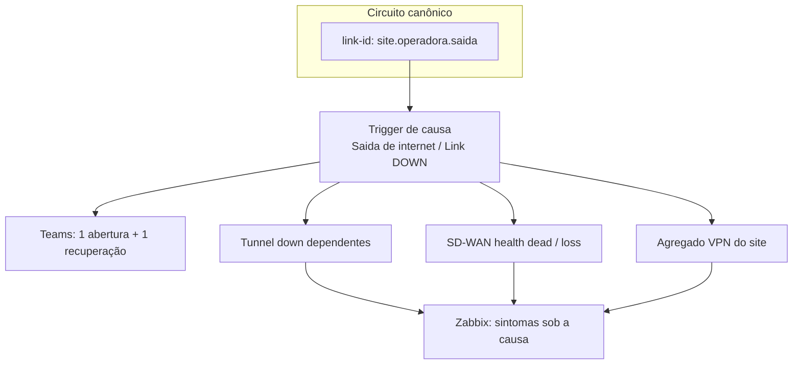

# Roadmap — mapa de todos os links que geram alerta no Zabbix

Data: 30/09/2026  
Escopo: 7 firewalls FortiGate (`SPO`, `SCL`, `BGP`, `BRAS`, `FIA`, `DENIM`, `Azure`)  
Objetivo: ter, para cada circuito, um mapa completo de **causa → sintomas → correlação → Teams**, e só então padronizar alertas.

Documentos relacionados:

- Correlação e ondas: `reports/roadmap-correlacao-links-zabbix-20260930.md`
- Hierarquia VPN/SD-WAN: `docs/roadmap-hierarquia-alertas-vpn-20260929.md`
- Matriz das 59 regras: `reports/link-correlation-matrix-20260930.csv`
- Inventário inicial (causas + agregados): `reports/mapa-links-alertas-inventario-20260930.csv`
- Ranker multi-firewall: `scripts/link_cause_rank_worker.py`

## Por que mapear antes de mudar

Hoje o Zabbix já gera alerta de link, mas a taxonomia está misturada (`SPO_VIVO`, `HK_VIVO`, `BGP_ISP2`, `BRAS_WAN1_VPN` etc.). Sem o mapa circuito a circuito:

1. correlação fecha ou reabre o sintoma errado;
2. o Teams recebe chuva de túnel/health-check em vez do link;
3. o SLA mistura queda real com perda de pacotes.

O incidente aberto da Vivo em SPO mostrou o caminho certo na prática: **uma causa (`18116214` / `SPO_VIVO`) e sintomas ranqueados nos 7 firewalls**, sem criar regra `close_new` nova.

## Modelo alvo por circuito

Regra operacional:

| Nível | O que alerta no Teams | O que fica só no Zabbix |
| --- | --- | --- |
| 1. Link | Causa com `notify=teams` | — |
| 2. Túnel isolado (link OK) | `Tunnel down` do túnel afetado | health/loss do mesmo membro |
| 3. Link do hub fora | Só a causa do hub | túneis e agregados dos sites remotos, ranqueados |

## Inventário já levantado (30/09)

### Causas físicas / “sem conectividade” — 11

| Host | Trigger | `link-cause` | Evento | Estado em 30/09 |
| --- | --- | --- | --- | --- |
| SPO-CPD-FW01 | 50308 | `SPO_VIVO` | Link HK_ISP1 (VIVO) DOWN | PROBLEM |
| SPO-CPD-FW01 | 50305 | `SPO_ALGAR` | Link HK_ISP2 (ALGAR) DOWN | OK |
| SCL-CPD-FW01 | 50306 | `HK_VIVO` | Link HK_VIVO (ISP1_VIVO) DOWN | OK |
| SCL-CPD-FW01 | 50307 | `SCL_ALGAR` | Link HK_ALGAR (ISP2_ALGAR) DOWN | OK |
| BGP-CPD-FW01 | 47636 | `BGP_ISP1` | Link HK_ISP1 (CROSSCNT) DOWN | OK |
| BGP-CPD-FW01 | 47620 | `BGP_ISP2` | Link HK_ISP2 (VIVO) DOWN | OK |
| BRAS-CPD-FW01 | 54333 | `BRAS_ISP1` | Saida 1 (CLARO) | OK |
| BR-SCL-FIA-FW01 | 54332 | `FIA_ISP1` | Saida 1 (CLARO DEDICADO) | OK |
| BR-SCL-FIA-FW01 | 54334 | `FIA_ISP2` | Saida 2 (CLARO BANDA LARGA) | OK |
| BR-DENIM-CAPRI-FW01 | 54452 | `DENIM_ISP1` | Saida 1 (FLEXUS) | OK |
| BR-DENIM-CAPRI-FW01 | 54451 | `DENIM_ISP2` | Saida 2 (ALGAR) | OK |

### Agregados VPN — 12

Existem pares WAN1/WAN2 (ou ISP1/ISP2) em SPO, SCL, BGP, BRAS, FIA e DENIM. Em 30/09 só `55144` (`SPO_ISP1_VPN`) estava em PROBLEM, já ranqueado sob `18116214`.

### Lacunas do mapa

| Lacuna | Impacto |
| --- | --- |
| `AZ-VM-FW-01` sem trigger “Saida de internet” | Azure só aparece como ponta de VPN/hub |
| `link-id` canônico ainda não preenchido | tags divergentes entre sites |
| `notify=teams` inconsistente nas causas físicas | parte das saídas só tem `telegram` na leitura parcial de tags |
| sintomas com `depends-on` vazio (ex.: `lan2`/`dmz`) | não entram na correlação determinística |
| 59 correlações com 27 valores de causa | manutenção manual e sobreposição (`close_new` gera tempestade) |
| túnel ↔ health-check: 34 de 81 sem casamento por nome | exige tabela explícita por host |

## Fases do roadmap

### Fase A — Matriz canônica de circuitos (3–4 dias)

Entrega: planilha completa em `reports/mapa-links-alertas-inventario-*.csv` + aba por firewall.

Para **cada** linha do inventário, preencher:

1. `link_id_canonico` no formato `site.operadora.saida` (ex.: `spo.vivo.isp1`)
2. interface física / membros SD-WAN de internet
3. lista de túneis e health-checks que dependem desse circuito (hub e ponta remota)
4. IDs das correlações atuais que citam o `link-cause`
5. se a causa deve ir ao Teams (`notify=teams`)
6. exceções: dial-up, admin down, parceiro externo sem health-check

Fontes para preencher:

- triggers de causa/agregado já exportadas neste inventário
- LLD VPN/SD-WAN do template `FortiGate by SNMP`
- tabela túnel↔membro de `docs/roadmap-hierarquia-alertas-vpn-20260929.md`
- matriz `reports/link-correlation-matrix-20260930.csv`

**Aceite:** 100% das saídas ISP dos 6 sites físicos com `link-id`; Azure documentado como hub/VPN; zero circuito “órfão”.

### Fase B — Congelar e classificar alertas atuais (2 dias)

1. Separar problemas abertos em: causa, sintoma ranqueável, independente, obsoleto.
2. Rodar `scripts/link_cause_rank_worker.py` em dry-run e aplicar só o que a matriz comprovar.
3. Fechar ou documentar problemas sem recuperação >24h.
4. Registrar baseline de 7 dias: eventos, Teams, flapping por `link-cause`.

**Aceite:** nenhuma causa aberta com sintomas soltos comprovados; baseline salva em `backups/`.

### Fase C — Padronizar tags na origem (1 semana)

Ordem segura: um circuito piloto por vez.

1. Aplicar contrato de tags da correlação (`class`, `component`, `scope`, `site`, `carrier`, `link-id`, `link-cause`, `notify`).
2. Sintomas: `depends-on=<link-id>`; perda de pacotes com `scope=performance`.
3. Preferir protótipo/template; host a host só para exceção de nome.
4. Garantir recuperação simétrica (abertura e fechamento).

Piloto sugerido: `spo.vivo.isp1` (já tem causa ativa e sintomas ranqueados).

**Aceite:** piloto com tags canônicas; symptoms novos nascem com `depends-on` correto.

### Fase D — Um alerta por causa no Teams (3–5 dias)

1. Causa aprovada: `notify=teams`.
2. Sintoma: sem `notify=teams`; permanece no Zabbix sob a causa.
3. Manter atraso de 5 minutos da ação 22.
4. Cartão: site, operadora, `link-id`, horário `dd/MM/yyyy HH:mm:ss`, duração, contagem de sintomas, link do evento.

**Aceite:** 1 abertura + 1 recuperação no Teams por queda de circuito no piloto.

### Fase E — Substituir `close_new` por ranking/dependência (2 semanas, por ondas)

| Onda | Circuitos | Critério para avançar |
| --- | --- | --- |
| 1 | `spo.vivo.isp1` + `spo.algar.isp2` | 7 dias sem tempestade e sem falso silêncio |
| 2 | `scl.vivo.isp1` + `scl.algar.isp2` | idem |
| 3 | `bgp.crosscnt.isp1` + `bgp.vivo.isp2` | redução ≥80% de ruído VPN |
| 4 | BRAS, FIA, DENIM | todos os testes causa/sintoma |
| 5 | Azure (VPN hub) | mapa de pontas validado |

Em cada onda:

1. backup das correlações e triggers do circuito;
2. desligar ou restringir `close_new` que provoque reabertura;
3. manter ranking automático (`link_cause_rank_worker`) ou dependência no template;
4. validar 4 sequências: causa→sintoma, sintoma→causa, recuperação, flapping dentro/fora de 5 min;
5. rollback se houver supressão cruzada de outra operadora.

### Fase F — Governança

1. Todo firewall/operadora novo entra pela matriz, não por correlação avulsa.
2. Dashboard: quedas por `link-id`, flapping, sintomas órfãos, problemas >24h, envios Teams.
3. Revisão semanal no 1º mês; mensal depois.
4. Ranker agendado **no servidor** próximo ao Zabbix (não na estação do usuário).

## Indicadores

- 100% dos circuitos físicos com linha na matriz e `link-id`.
- 100% dos sintomas VPN/SD-WAN com `depends-on` válido.
- ≥80% menos notificações de sintoma no Teams.
- 1 abertura e 1 recuperação por incidente de operadora.
- 0 problema de link sem recuperação >24h sem justificativa.
- 0 sintoma de outra operadora ranqueado/fechado pela causa errada.

## O que já está pronto hoje

| Item | Status |
| --- | --- |
| 59 correlações inventariadas | Feito |
| 11 causas + 12 agregados listados | Feito |
| **Fase A — mapa canônico (`link-id` + túneis)** | **Feito em 30/09/2026** |
| **Fase B — classificação + ranker** | **Feito em 30/09/2026** |
| **Fase C — tags piloto `spo.vivo.isp1`** | **Feito** (causa+agregado+protótipos LLD) |
| **Fase D — Teams só com `notify=teams`** | **Feito em 30/09/2026** |
| **Fase E — piloto sem `close_new` SPO** | **Feito em 30/09/2026** (16/45 off; 17/46 on) |
| **Fase F — governança** | **Documentada em 30/09/2026** |
| Incidente SPO Vivo ranqueado nos 7 FWs | Feito (50 sintomas sob `18116214`) |
| Ranker multi-firewall | Feito (`scripts/link_cause_rank_worker.py`) |
| Roadmap de correlação e hierarquia VPN | Feito (docs anteriores) |
| Padronização Teams só na causa | Pendente — Fase D |
| Troca controlada das regras `close_new` | Pendente — Fase E |

### Entregas da Fase A (30/09/2026)

- Planilha canônica: `reports/mapa-links-alertas-canonico-20260930.csv`
- Relatório por circuito: `reports/mapa-links-alertas-fase-a-20260930.md`
- Gerador reproduzível: `scripts/build_phase_a_link_map.py`
- Convenção aplicada: `site.operadora.saida` (ex.: `spo.vivo.isp1`); agregados com `.vpn-agg` e `parent_link_id`
- `spo.vivo.isp1`: 5 health-checks `ISP1_VIVO` na causa `50308` + **16** túneis casados nos 7 firewalls
- Matcher de `depends-on` ajustado para não misturar variantes `_W1`/`_W2`

### Entregas da Fase B (30/09/2026)

- Decisão: `BGPISP2_MTZISP1` e `SCLISP2_MTZISP1` permanecem sob `spo.vivo.isp1` (prefixo `MTZISP1`)
- Classificação: `reports/phase-b-classificacao-problemas-fw-20260930.md` + CSV
- 57 problemas nos FWs: 1 causa Vivo + 50 sintomas ranqueados + 5 independentes + 1 outra causa
- Dry-run do ranker: 0 candidatos (nada a aplicar)
- Stale >24h listados; **não fechados** sem revisão pontual

### Entregas da Fase C (30/09/2026) — piloto

- Relatório: `reports/phase-c-spo-vivo-tags-20260930.md`
- `50308`: `link-id=spo.vivo.isp1`, `carrier=vivo`, `class=network`, `component=wan-link`; `link-cause=SPO_VIVO` mantido
- `55144`: `link-id=spo.vivo.isp1.vpn-agg`, `depends-on=SPO_VIVO`; sem `notify=teams`
- Protótipos `23665`/`23666`: `scope` + `class` + `component`
- Correlações 16/17/45/46: ver Fase E

### Entregas D/E/F (30/09/2026)

Relatório completo: `reports/phases-cdef-execucao-20260930.md`

- **D:** ação 22 passou a `notify=teams` apenas; 12 agregados sem Teams; 11 causas físicas com Teams
- **E:** correlações 16 e 45 (`close_new`) desabilitadas; 17 e 46 (`close_old`) ativas
- **F:** regras operacionais + cadência + rollback documentados

## Próximo passo recomendado

Observar **7 dias** o piloto SPO Vivo (sem tempestade, Teams só na causa). Se ok, onda 2: SCL (`close_new` 11/35).

Cada circuito preenchido vira candidato a piloto da Fase C/D sem adivinhar tags.

## Como executar mudanças

Qualquer alteração no Zabbix segue o runbook `zabbix-senior-analyst`: backup em `backups/` → mudança mínima → validação de item/trigger/evento/Teams → rollback se piorar. Métodos `delete` permanecem bloqueados no MCP; objetos redundantes são desativados.
